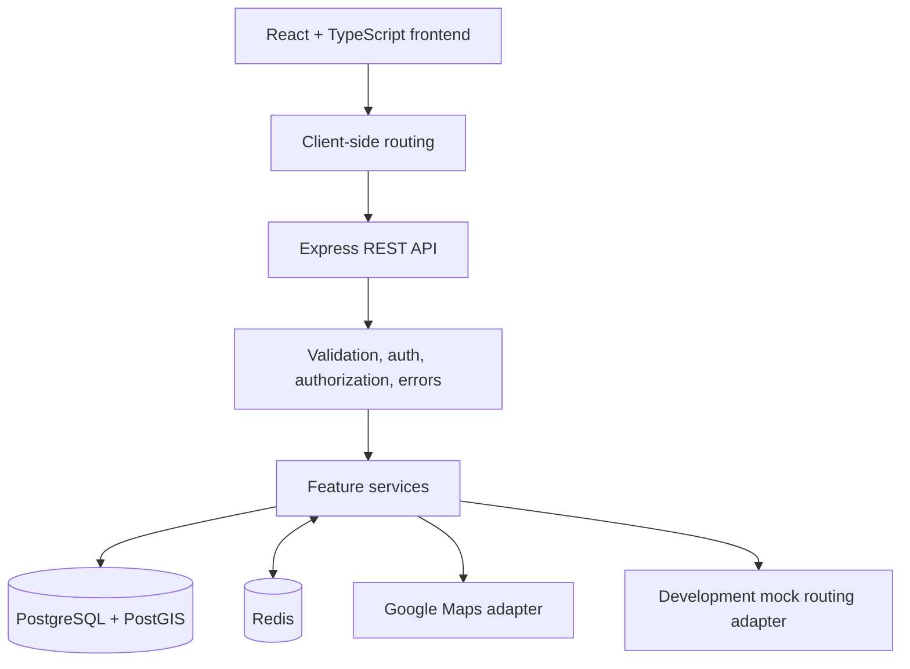
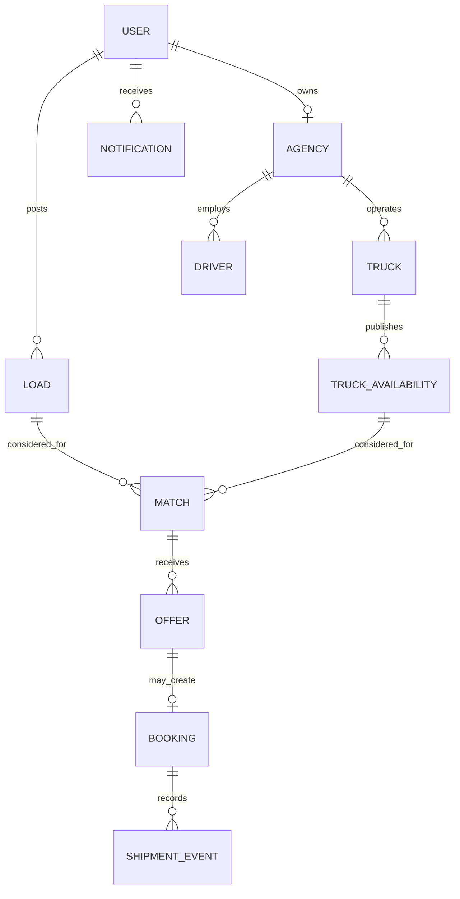

# MoveNet — Living Technical Explanation

> **Implementation status:** Stage 1 is complete and verified locally. Stage 2 is
> in progress; Batches 1–5 compile and build successfully, while final review and
> user confirmation remain pending. This document separates verified implementation
> from future design so the project is described truthfully in interviews,
> portfolios, and LinkedIn posts.

For the detailed delivery order and architecture roadmap, see
[PLANNING.md](PLANNING.md).

## 1. Project introduction

MoveNet is a full-stack logistics marketplace in development. It aims to help a
shipper find suitable transport capacity and help a transport provider find a useful
load for a planned return journey.

The project begins with a reliable web and infrastructure foundation, then grows into
secure accounts, marketplace data, geographic filtering, explainable matching, and
safe booking flows.

## 2. Real-world problem

A truck may complete a delivery but travel home with unused capacity. That empty
return trip still consumes fuel, driver time, and vehicle availability. At the same
time, a shipper may be trying to find a carrier along a compatible route through
phone calls, spreadsheets, or personal contacts.

MoveNet explores a structured alternative: record the shipment need and a truck's
planned availability, then explain when they may fit each other. It does not claim to
have already reduced empty miles or optimized logistics at scale.

## 3. Proposed solution

MoveNet is designed for three roles:

- **Shippers** post and manage transportation needs.
- **Transport agencies** manage trucks, drivers, and planned availability.
- **Administrators** oversee accounts, verification, and platform operations.

The intended workflow is:

1. A shipper records cargo, pickup, delivery, timing, and capacity needs.
2. A transport provider publishes a truck's planned route and availability.
3. The matching engine excludes invalid candidates first.
4. It ranks remaining candidates with a transparent, configurable score.
5. Providers can make offers, and accepted offers later become safe, auditable
   bookings.

## 4. Technology stack

| Area | Technology | Current use |
|---|---|---|
| Frontend | React, TypeScript, Vite | Implemented foundation and public routes |
| Styling | Tailwind CSS | Implemented tokens, responsive layout, and reusable UI styling |
| Navigation | React Router | Implemented public, authentication-preview, and dashboard-preview routes |
| Icons | Lucide React | Implemented accessible interface icons |
| Backend | Node.js, Express, TypeScript | Implemented API foundation and health endpoints |
| Validation | Zod | Installed for backend request-boundary validation work |
| Database | PostgreSQL + PostGIS | Local services verified; schema work is planned for Stage 4 |
| Cache | Redis | Local service verified; caching and rate limits are planned for Stage 8 |
| Data access | Prisma + parameterized SQL | Planned; Prisma schema has not been created yet |
| Routing data | Google Maps adapter plus mock adapter | Planned for Stage 5 |
| Testing | Vitest and Supertest | Planned for later stages |
| Infrastructure | Docker Compose | Implemented for local PostgreSQL/PostGIS and Redis |

### Why this stack

React and TypeScript provide a typed, component-based frontend. Express keeps the
backend lightweight while allowing modular feature boundaries. PostgreSQL is a good
fit for durable marketplace relationships and transactions. PostGIS brings spatial
types and indexed geographic queries close to the data. Redis is intended for
short-lived derived data and shared rate-limit state, not critical booking truth.

## 5. System architecture



### Current request path

The frontend currently has browser routes for the landing page; workflow, shipper,
agency, and about pages; login and registration previews; and role-specific dashboard
previews for shippers, transport agencies, and administrators. Login and registration
forms do not contact the API yet. Dashboard pages show reusable interface states but
no live backend data.

The About-page contact form is a local interaction preview only: it shows an honest
notice that no message was sent or stored. Public workflow and solution copy describes
planned capabilities and does not claim active matching, booking, or optimization.

The existing backend exposes health endpoints. The dependency health endpoint checks
that the API can reach PostgreSQL/PostGIS and Redis.

### Planned request path

For future marketplace requests, Express routes will call controllers, controllers
will call services, and services will use repositories or focused data-access modules.
Zod will validate untrusted input before business logic runs. Authentication and
resource authorization will be middleware and service concerns, not frontend-only
checks.

## 6. Database architecture

The Stage 4 database design is planned around normalized relationships:

| Entity | Purpose |
|---|---|
| User | Account identity, role, password hash, and status |
| Agency | Transport-provider organization |
| Truck | Agency-owned vehicle, capacity, and cargo properties |
| Driver | Agency driver information |
| TruckAvailability | Planned truck route and time window |
| Load | Shipper shipment request |
| Match | A derived candidate recommendation, not a booking |
| Offer | A provider's commercial proposal |
| Booking | Confirmed agreement and lifecycle status |
| ShipmentEvent | Immutable booking/shipment history |
| Notification | User-facing platform event |



Important planned rules include fixed-precision money, UTC timestamps, foreign keys,
unique constraints, PostgreSQL transactions for bookings, and GiST indexes for
spatial columns.

## 7. API architecture

The Express API is organized toward a modular monolith. Intended feature modules are
`auth`, `users`, `agencies`, `trucks`, `drivers`, `loads`, `availability`,
`matching`, `offers`, `bookings`, `notifications`, and `admin`.

Current endpoints:

| Method | Path | Purpose |
|---|---|---|
| `GET` | `/api/v1/health` | Confirms that the Express application responds |
| `GET` | `/api/v1/health/dependencies` | Confirms PostgreSQL/PostGIS and Redis connectivity |

Future list endpoints will use pagination. Future errors will use a consistent,
client-safe shape and must not expose secrets or stack traces.

## 8. Authentication and security

### Implemented boundary

Stage 2 includes only authentication **screens**. The login and registration forms:

- use native HTML validation and accessible labels;
- provide a password visibility control;
- provide client-side password-match feedback during registration; and
- do not send, store, hash, log, or persist credentials.

### Planned implementation

Stage 3 will add Argon2id password hashing, JWT access tokens, role-based
authorization, resource-level ownership checks, and secure session/logout behavior.
TypeScript alone is not runtime validation, so Zod validates external inputs at the
API boundary.

Security principles include no hard-coded secrets, CORS configuration, safe logs,
short-lived access tokens, and a deliberate refresh-token/CSRF strategy if cookies
are used.

## 9. Geospatial architecture

PostGIS will be used for geographic candidate filtering, such as identifying pickup
or delivery points near a planned route. A spatial filter is not the same as a road
route calculation.

Stage 5 will place Google Maps calls behind a backend adapter for geocoding, route
distance, and travel-time estimates. A development adapter can provide deterministic
mock values, but those values must always be clearly labeled as simulated.

## 10. Matching algorithm

The first matching engine is intentionally deterministic and rule-based.

1. Filter by relevant time windows.
2. Reject insufficient capacity or incompatible cargo.
3. Check pickup and delivery order against the planned route.
4. Reject excessive proximity or detour candidates.
5. Estimate travel-time and distance cost when routing data is available.
6. Score eligible candidates and return an explanation.

An illustrative, configurable score is:

```text
Score =
    0.35 × RouteCompatibility
  + 0.25 × Profitability
  + 0.20 × TimeCompatibility
  + 0.20 × CapacityUtilization
```

The weights are starting assumptions, not a mathematically proven optimum. Filtering
first keeps the first scoring pass approximately `O(n)` over already relevant
candidates, while PostGIS indexes reduce the initial search space.

## 11. Redis caching

Redis is verified as a local dependency but is not yet used for application caching
or rate limiting.

The planned pattern is cache-aside:

1. Check Redis for an eligible, short-lived value.
2. On a miss, load from PostgreSQL or a routing provider.
3. Store the derived response with a bounded TTL.
4. Invalidate or refresh relevant keys when underlying data changes.

PostgreSQL remains the source of truth. If Redis is unavailable, safe cache reads
should fall back to the authoritative source. Redis must never decide whether a
booking exists.

## 12. Booking consistency

Booking has not been implemented. Its future design must protect against duplicate
or conflicting bookings under retries and concurrent requests.

The planned approach uses PostgreSQL transactions, conditional state transitions,
database constraints, and durable idempotency keys. Accepting an offer and reserving
availability must succeed or fail together. Shipment events should preserve history
instead of overwriting it.

## 13. Development stages

| Stage | Status | Evidence |
|---|---|---|
| 0 — Architecture and planning | Completed | Architecture and roadmap documented |
| 1 — Project setup | Completed | Health checks, Docker services, and TypeScript checks verified locally |
| 2 — Premium frontend foundation | In progress | Batches 1–5 compile and production-build locally; dashboard previews were verified in the browser earlier, while final Stage 2 review/user confirmation is pending |
| 3 — Authentication and authorization | Planned | No backend authentication yet |
| 4 — Database and core marketplace | Planned | No Prisma schema or marketplace APIs yet |
| 5 — Geospatial foundation | Planned | Local PostGIS service is ready; geographic workflows are not built |
| 6 — Matching engine | Planned | Rule design only |
| 7 — Offers and bookings | Planned | Design only |
| 8 — Redis optimization | Planned | Redis connectivity only |
| 9 — Notifications and administration | Planned | Not started |
| 10 — Testing, security, and reliability | Planned | Initial checks only |
| 11 — Deployment | Planned | Not deployed |
| 12 — Portfolio and interview preparation | In progress | Documentation and truthful project descriptions started |

## 14. Engineering decisions

| Decision | Choice | Reason and trade-off |
|---|---|---|
| Architecture | Modular monolith | Easier early deployment and transactions than microservices; modules still preserve boundaries. |
| API style | REST | Fits resource-oriented marketplace flows and standard HTTP tooling. |
| Primary database | PostgreSQL | Strong relationships, constraints, and transactions for bookings. |
| Spatial support | PostGIS | Geographic types and indexes outperform application-only broad filtering. |
| Matching | Deterministic rules first | Explainable and testable without training data; weights need later validation. |
| Cache | Redis for derived data | Helps repeated reads and rate limits, but adds invalidation/failure complexity. |
| Routing provider | Google Maps adapter | Isolates vendor details; API cost, quota, and outages remain concerns. |
| Frontend router | React Router | Enables page-level UI without full browser reloads. |

## 15. Problems encountered and solutions

| Problem | Cause | Resolution | Verification |
|---|---|---|---|
| Initial backend start failed because `createApp` was not exported. | The server imported a named export that the app module did not provide. | The app module and server import were aligned. | API health endpoint returned a successful JSON response. |
| Initial PostGIS Docker image did not support Apple Silicon. | The selected image lacked a `linux/arm64/v8` manifest. | Switched to a pinned ARM64-compatible Kartoza PostGIS image. | Docker service became healthy and `PostGIS_full_version()` returned PostGIS 3.7.0. |
| Frontend initially imported `App.js` from TypeScript. | The application component was saved as JavaScript while strict TypeScript expected declarations. | Converted the component to `App.tsx` and aligned the import. | Frontend typecheck passed. |
| Reusable form fields failed strict optional-property typing. | Optional props were passed explicitly as `undefined` under `exactOptionalPropertyTypes`. | Allowed explicit `undefined` for the relevant display-only props. | Frontend `npm run typecheck` passed. |

## 16. Performance benchmarks

No latency, throughput, matching-quality, or scalability benchmark has been measured.
Future entries must record the environment, data size, scenario, method, result, and
caveat. Architectural choices must never be presented as measured performance gains.

## 17. Interview explanation

### 30-second pitch

> MoveNet is a logistics marketplace in development that aims to reduce empty truck
> return journeys. I have built the local React frontend foundation and an Express
> API foundation with PostgreSQL/PostGIS and Redis services. The next product steps
> are secure accounts, marketplace data, and explainable route-aware matching.

### 60-second pitch

> MoveNet addresses the gap between a truck's planned return journey and a shipper's
> need for capacity along a compatible route. Its architecture is a modular monolith:
> a React and TypeScript frontend, an Express REST API, PostgreSQL/PostGIS for durable
> and spatial data, and Redis for later caching and rate limiting. The current build
> has responsive public workflow and solution pages, browser routes, UI-only
> authentication screens, and verified backend dependency health checks. The first
> matching version will filter hard constraints and then rank eligible options with an
> explainable score.

### 2-minute technical explanation

> I chose a modular monolith because MoveNet will need transactions around future
> bookings but does not yet benefit from microservice operational complexity. The
> frontend uses React, TypeScript, Tailwind, and React Router. Stage 2 establishes
> reusable UI components and routes, but keeps authentication UI-only so it does not
> falsely imply secure account handling exists. The Express API has health endpoints
> and validates its environment. PostgreSQL/PostGIS and Redis run in Docker locally.
>
> The core future workflow starts with load and truck-availability data. PostGIS will
> filter spatial candidates; a routing adapter will evaluate real route detours;
> deterministic rules will reject invalid candidates by capacity, cargo, time, and
> route ordering. PostgreSQL transactions and idempotency will later protect booking
> state, while Redis stays non-authoritative.

### 5-minute system-design walkthrough

1. Explain the empty-return problem and the two-sided marketplace.
2. Describe the React frontend, Express API, PostgreSQL/PostGIS, and Redis layout.
3. Distinguish current implementation from planned marketplace features.
4. Explain spatial filtering versus actual routing estimates.
5. Explain filter-first, score-second matching and why it is explainable.
6. Explain why PostgreSQL, not Redis, owns booking correctness.
7. Describe growth through indexes, pagination, routing-call control, and measured
   scaling rather than premature microservices.

## 18. Interview questions

1. **Why PostgreSQL instead of MongoDB?** Marketplace relationships, constraints,
   and transactions are central to future booking workflows.
2. **Why PostGIS?** It adds spatial types, geographic functions, and indexes to
   PostgreSQL.
3. **Can PostGIS calculate driving time?** No; routing-provider data is needed for
   road distance and travel time.
4. **Why a modular monolith?** It preserves feature boundaries with easier early
   deployment and transaction handling.
5. **Why REST?** The product is resource-oriented and does not need GraphQL's query
   flexibility yet.
6. **Why TypeScript if Zod exists?** TypeScript helps at compile time; Zod validates
   untrusted runtime input.
7. **What does the current health endpoint prove?** The API responds; the dependency
   endpoint separately proves current database/cache connectivity.
8. **Why have two health checks?** An API process can run while a dependency is down.
9. **What is currently implemented in Stage 2?** Landing, workflow, solution, and
   about pages; responsive routed navigation; UI-only authentication screens;
   dashboard-shell previews; and reusable form, feedback, table, modal, toast, and
   skeleton components. The marketplace itself is not live yet.
10. **Do login and registration create accounts today?** No; they deliberately do not
    send or store credentials before Stage 3.
11. **How will passwords be stored?** With Argon2id hashes, never plaintext.
12. **What does a JWT not do?** It does not replace expiry, ownership checks, or
    token-revocation planning.
13. **Why check resource ownership after authentication?** A valid identity should
    not access every shipment or truck.
14. **Why Redis?** For future short-lived cached data and rate-limit state.
15. **What if Redis fails?** Safe cache reads should fall back to PostgreSQL; its
    failure policy must be explicit for rate limits.
16. **Why is Redis not booking authority?** It is not the durable transactional source
    needed for correctness.
17. **How does matching begin?** By rejecting capacity, cargo, time, route-order, and
    detour violations before scoring.
18. **Are matching weights optimal?** No; they are configurable starting assumptions.
19. **What is the basic matching complexity?** Approximately `O(n)` over prefiltered
    candidates, while spatial indexes reduce the input set.
20. **How will route deviation be calculated?** Compare the planned route with a
    route including pickup and delivery using routing estimates.
21. **Why separate match, offer, and booking?** They represent a recommendation, a
    commercial proposal, and a confirmed agreement.
22. **How will overbooking be avoided?** PostgreSQL transactions, conditional writes,
    locking/constraints, and idempotent booking requests.
23. **Why might one unique booking constraint be insufficient?** One truck can have
    overlapping availability records that need a separate conflict rule.
24. **What is idempotency?** Repeating the same request safely returns the original
    effect instead of creating duplicates.
25. **Why Docker Compose?** It makes local infrastructure repeatable across machines.
26. **What Apple Silicon issue occurred?** A PostGIS image lacked an ARM64 manifest;
    switching images resolved it.
27. **Why use a routing adapter?** It isolates Google Maps details, failures, quotas,
    and a development mock behind one boundary.
28. **How do you distinguish mock distances?** Mark the source/mode as simulated in
    API and UI output.
29. **How should list APIs scale?** Use bounded pagination, stable ordering, indexes,
    and avoid over-fetching.
30. **How would MoveNet scale further?** Measure bottlenecks first, then tune queries,
    pools, caches, API instances, and background work before splitting services.

## 19. Resume and LinkedIn

### Truthful resume bullets today

- Built a responsive React, TypeScript, Vite, and Tailwind CSS foundation for a
  logistics-marketplace project, including reusable UI components, public workflow
  and solution pages, client-side routes, and role-specific dashboard shells.
- Implemented UI-only sign-in and registration previews that use accessible native
  validation without falsely persisting credentials before backend authentication.
- Created an Express and TypeScript API foundation with Dockerized PostgreSQL/PostGIS
  and Redis dependency-health checks.

### LinkedIn project description today

> Building MoveNet, a logistics marketplace project focused on reducing empty truck
> return journeys. The current foundation includes a responsive React and TypeScript
> interface, public workflow and solution pages, UI-only authentication screens, and
> an Express API with local PostgreSQL/PostGIS and Redis connectivity checks. Secure
> accounts, route-aware matching, and booking flows are the next implementation
> milestones.

Never claim user adoption, cost savings, freight volume, optimized routes, or measured
performance until those outcomes exist and can be supported with evidence.

## 20. Future improvements

- Secure registration, login, sessions, JWTs, and authorization.
- Prisma schema, migrations, agency profiles, trucks, drivers, and loads.
- PostGIS proximity filters and a Google Maps routing adapter.
- Single-load rule-based matching with explanations and tests.
- Transactional offers, bookings, idempotency, and shipment events.
- Redis cache-aside logic, invalidation, and rate limiting.
- Notifications, administration, audit logs, broader test coverage, and deployment.
- Only after a dependable single-load flow: multi-load planning, multi-stop routes,
  feedback-driven matching improvements, and operational scaling work.
