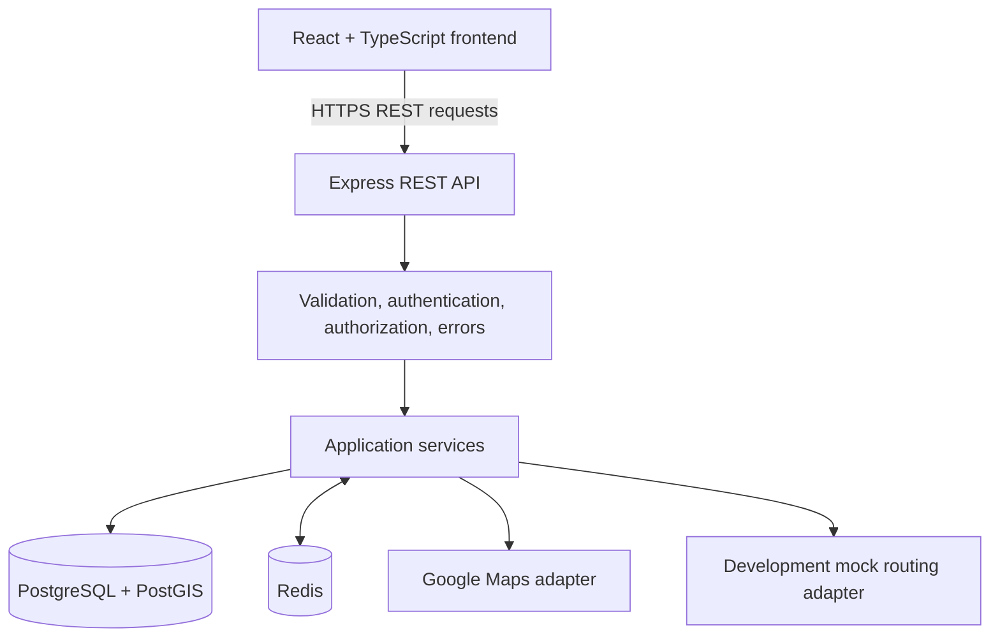
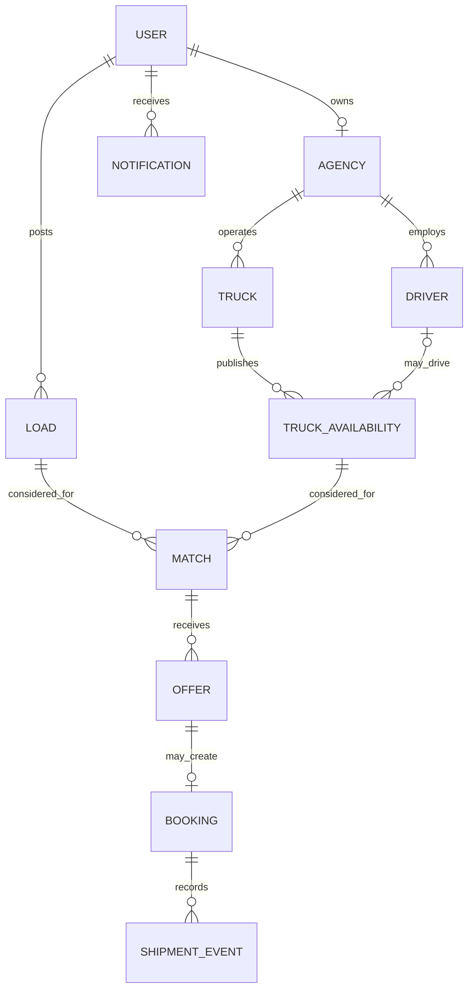

# MoveNet — Project Explanation

> **Current status:** Stages 0 and 1 are complete and verified locally.
> No application feature is marked implemented or tested until its execution results
> are confirmed.

## 1. Project introduction

MoveNet is a planned logistics marketplace connecting shippers who need goods moved
with transport providers who have trucks and routes. Its main goal is to help providers
find suitable shipments for trucks that might otherwise return empty.

The planned application uses a React and TypeScript frontend, a Node.js and Express
API, PostgreSQL with PostGIS, and Redis for selected caching and rate-limiting work.
This document records the intended design and confirmed implementation status.

## 2. Real-world problem

A transport provider may deliver cargo far from its base and then return without
another shipment. The return trip still consumes fuel, driver time, vehicle capacity,
and other operating resources. Empty running can reduce earnings and fleet utilization.

Shippers also need a way to find providers that can carry a shipment at the right time
and along a suitable route. Manual discovery can take time and may miss return-trip
opportunities.

## 3. Proposed solution

MoveNet is planned as a marketplace with three main roles:

- **Shippers** create and manage shipment requests.
- **Transport providers** manage agencies, trucks, drivers, and availability.
- **Administrators** oversee accounts and platform operations.

The matching workflow will first reject candidates that fail required constraints,
such as capacity, cargo compatibility, time-window feasibility, or route order. It
will then rank eligible candidates using a configurable, deterministic score.

A recommendation is an opportunity to review, not a guarantee of profitability or
operational feasibility.

## 4. Technology stack

| Technology | Planned role |
|---|---|
| React | Frontend UI and dashboards |
| TypeScript | Static typing in frontend and backend |
| Vite | Frontend development and build tooling |
| Tailwind CSS | Responsive styling and shared design tokens |
| React Router | Frontend navigation |
| Lucide React | UI icons |
| Node.js | Backend runtime |
| Express | REST API and middleware |
| Zod | Runtime validation for incoming data |
| PostgreSQL | Durable relational data and transactions |
| PostGIS | Indexed geographic queries |
| Prisma | Routine relational access and migrations |
| Redis | Selected caching and rate-limit state; not booking authority |
| Google Maps Platform | Planned geocoding and route estimates through a backend adapter |
| Docker Compose | Local PostgreSQL/PostGIS and Redis services |
| Vitest | Planned unit tests |
| Supertest | Planned API integration tests |
| Git and GitHub | Version tracking and collaboration |
| Vercel | Planned frontend hosting |
| Render or equivalent | Planned Node.js API hosting |

### Backend setup versions for Stage 1

These exact versions are configured in `backend/package.json`:

| Package | Version |
|---|---:|
| Node.js runtime target | >=22.18.0 <25 |
| Express | 5.3.0 |
| Zod | 4.6.7 |
| dotenv | 18.0.10 |
| pg | 8.23.1 |
| redis | 6.3.1 |
| TypeScript | 7.0.2 |
| tsx | 4.23.15 |
| @types/express | 5.0.6 |
| @types/node | 22.20.5 |

The project was verified locally with Node.js 22.23.4.

### Planned environment configuration

Local environment variables will be kept outside tracked source files. Expected names:

- `NODE_ENV`
- `PORT`
- `FRONTEND_ORIGIN`
- `DATABASE_URL`
- `REDIS_URL`

Google Maps and authentication settings will be added in later stages. Example values
will be clearly marked as development-only.

### Stage 1 verification results

- Backend TypeScript check passed with `npm run typecheck`.
- Frontend TypeScript check passed with `npm run typecheck`.
- The Express API health endpoint returned a successful response.
- The dependency health endpoint successfully reached PostgreSQL/PostGIS and Redis.
- Docker Compose reported PostgreSQL/PostGIS and Redis as healthy.
- A PostGIS query confirmed PostGIS 3.7.0, and Redis returned `PONG`.

## 5. System architecture



The mock routing adapter supports development when Google Maps credentials are
unavailable. Its output must be identified as simulated and must never be presented as
a real-world distance or travel time.

### Request lifecycle

1. The browser sends an HTTP request to an Express route.
2. Middleware performs applicable parsing, authentication, authorization, and Zod
   validation.
3. A controller translates between HTTP and application code.
4. A service applies the relevant business rules.
5. The service reads or writes PostgreSQL using Prisma or an isolated, parameterized
   PostGIS query.
6. Redis may be used for eligible short-lived cached data or rate-limit state.
7. The API returns a consistent success or error response.
8. The frontend renders the result, loading state, empty state, or error state.

### Architecture choice

MoveNet is planned as a **modular monolith**: one backend application organized into
feature modules. This keeps early deployment and transactions straightforward while
retaining clear boundaries. Microservices are not planned unless measured needs
justify them.

## 6. Database architecture

The database will be relational and normalized around users, agencies, trucks,
availability, shipment loads, matches, offers, bookings, events, and notifications.
The Prisma schema and migrations will be introduced in Stage 4.

### Initial entities and relationships

- **User** stores account identity, password hash, role, and account state.
- **Agency** represents a transport provider organization and has an owner account.
- **Truck** belongs to an agency and records vehicle capacity and cargo properties.
- **Driver** belongs to an agency. Availability can identify its planned driver.
- **TruckAvailability** represents a truck’s planned route and time window. It may
  store geographic endpoints and a route line.
- **Load** represents a shipper’s request, cargo details, capacity needs, and
  pickup/drop-off windows.
- **Match** records a load and availability candidate produced by matching.
- **Offer** represents a provider’s commercial offer for a candidate shipment.
- **Booking** records the confirmed agreement and current lifecycle state.
- **ShipmentEvent** records important booking status changes as history.
- **Notification** records a user-facing platform event.



The initial diagram uses a one-to-one User/Agency ownership relationship. If multiple
agency members are needed, we can introduce an explicit membership relationship.

### Data rules to implement

- Use primary keys, foreign keys, unique constraints, and useful indexes.
- Add GiST spatial indexes for geography columns used in proximity queries.
- Store money as fixed-precision decimal values, never floating-point values.
- Store timezone-aware timestamps and use UTC application conventions.
- Use transactions and concurrency controls for booking operations.
- Preserve booking and shipment event history.
- Check both role permissions and resource ownership.
- Use parameterized SQL for custom PostGIS operations.

A candidate match is derived data. It is not the same thing as a confirmed booking.
PostgreSQL remains the durable source of truth.

## 7. API architecture

The backend will expose REST endpoints grouped by feature module. Exact paths and
request/response schemas will be documented as they are implemented.

Planned API areas:

- Authentication and account profile.
- Agency, truck, driver, and availability management.
- Load creation, search, and details.
- Match discovery and explanations.
- Offers and booking lifecycle.
- Notifications.
- Administrative review and reports.
- Health checks.

Routes map HTTP methods and paths. Controllers handle HTTP translation. Services own
business rules. Prisma handles ordinary data access; parameterized SQL handles
focused PostGIS queries. Middleware handles shared concerns.

List endpoints will use bounded pagination. Errors will have a consistent client-safe
shape and will not expose stack traces or secrets.

## 8. Authentication and security

The planned authentication system uses Argon2id password hashing, JWT access tokens,
and role-based authorization. Authentication identifies the caller; authorization
checks whether that caller can perform an action on the specific resource.

Security rules:

- Validate external data with Zod at API boundaries.
- Never store plaintext passwords or hardcode real secrets.
- Check ownership when accessing loads, trucks, offers, and bookings.
- Validate required environment settings at application startup.
- Configure CORS for intended frontend origins.
- Do not log passwords, tokens, or sensitive data.
- Use secure cookie settings and a deliberate CSRF strategy if refresh tokens use
  cookies.
- Keep access tokens short-lived and define a revocation/refresh plan.
- Return safe errors to clients without exposing internals.

A valid JWT does not grant access to every record and does not replace authorization
checks or expiry planning.

## 9. Geospatial architecture

PostGIS will support geographic filtering, such as finding pickup or drop-off points
near a planned route. Its spatial types and indexes let geographic queries run close
to the stored data.

Google Maps Platform will be accessed through a backend adapter for geocoding and
route or travel-time estimates. Provider-specific details should remain inside that
integration layer.

The development mock adapter returns simulated data. It must be labeled as such.
Straight-line proximity can filter rough candidates, but it is not the same as road
distance or driving time.

A route match has two parts:

1. **Geographic candidate filtering:** check whether shipment points are close enough
   to a route or configured corridor.
2. **Route cost evaluation:** estimate the additional distance or time needed to serve
   the load using routing data.

Provider outages, quotas, invalid coordinates, and incomplete responses need explicit
handling.

## 10. Matching algorithm

The first matching version will be deterministic and rule-based.

### Planned filtering sequence

1. Find truck availability records that overlap the load’s time window.
2. Reject trucks that lack payload capacity or cargo compatibility.
3. Check that pickup and drop-off are served in the correct route order.
4. Reject candidates exceeding configured proximity or detour limits.
5. Estimate remaining time and detour cost when route data is available.
6. Score eligible candidates and return a reason for the recommendation.

Initial illustrative score:

```text
Score =
    0.35 × RouteCompatibility
  + 0.25 × Profitability
  + 0.20 × TimeCompatibility
  + 0.20 × CapacityUtilization
```

Each component must be normalized to a documented scale. Weights are configurable
assumptions, not a mathematically optimal formula. A score ranks candidates; it does
not guarantee profit, safety, or schedule feasibility.

For `n` prefiltered candidates with constant-time checks, a simple filter-and-score
pass is approximately `O(n)`. Spatial indexes reduce the number of candidates that
need application-level evaluation. External route calls may dominate latency and
cost.

Multiple loads, multiple stops, and route sequencing are future work, after the
single-load workflow is dependable.

## 11. Redis caching

Redis is planned for selected short-lived cache-aside data and shared rate-limit
counters. PostgreSQL remains authoritative.

A cache-aside read checks Redis, loads from the database or provider on a miss, then
stores the result with a configured TTL. Mutations must invalidate or refresh affected
cache keys. The relevant keys and rules will be defined with each feature.

If Redis is unavailable, safe cache reads should fall back to the authoritative source.
Rate-limiting behavior needs an explicit failure policy, especially on authentication
and abuse-sensitive routes. No cache performance improvement has been measured.

## 12. Booking consistency

Booking is a critical write and must remain correct under retries and concurrent
requests. The planned design uses PostgreSQL transactions and database-backed state
transitions, not Redis locks as the source of truth.

The implementation should:

- Define permitted offer and booking status transitions.
- Make offer acceptance and availability reservation atomic.
- Use row locking or conditional updates so competing requests cannot both claim the
  same bookable availability.
- Add uniqueness or exclusion constraints for conflicts represented in the schema.
- Use durable idempotency keys for retryable booking creation.
- Preserve shipment events for history.

A unique booking per availability may not prevent conflicts if overlapping availability
records exist for one truck. That case needs an explicit database-level conflict rule.

## 13. Development stages

| Stage | Scope | Status | Tested |
|---|---|---|---|
| 0 | Architecture and project planning | Completed | Not applicable; planning only |
| 1 | Vite frontend, Express API, health endpoint, Docker services, configuration | Completed | Verified locally: TypeScript checks, API health checks, PostgreSQL/PostGIS, and Redis |
| 2 | Design system, landing page, routing, authentication screens, dashboard shells | Planned | Not yet |
| 3 | Registration, login, password hashing, JWT, role and resource authorization | Planned | Not yet |
| 4 | PostgreSQL schema/migrations and core marketplace APIs | Planned | Not yet |
| 5 | Location model, PostGIS, geocoding, route adapter, geographic queries | Planned | Not yet |
| 6 | Candidate filters, detour/time checks, scoring, explanations, and tests | Planned | Not yet |
| 7 | Offers, bookings, transactions, idempotency, and shipment events | Planned | Not yet |
| 8 | Redis caching, invalidation, rate limiting, metrics, and tests | Planned | Not yet |
| 9 | Notifications, administration, verification, reports, and audit logging | Planned | Not yet |
| 10 | Broader tests, security review, and measured performance work | Planned | Not yet |
| 11 | Production configuration and deployment preparation | Planned | Not yet |
| 12 | Portfolio materials and interview preparation from verified implementation | Planned | Not yet |

A feature is only marked completed after its agreed implementation scope is done.
Testing status changes only after actual results are provided.

## 14. Engineering decisions

| Decision | Planned choice | Reason and trade-off |
|---|---|---|
| Primary database | PostgreSQL | Relational constraints and transactions suit marketplace and booking relationships. |
| Geographic queries | PostGIS | Provides spatial types and indexed operations; application-only calculations do not efficiently filter large datasets. |
| Application architecture | Modular monolith | Keeps early deployment and transaction flows simpler than microservices while preserving feature boundaries. |
| API style | REST | Fits the resource-oriented workflows and standard HTTP tooling. |
| Matching | Deterministic rules and configurable score | Explainable and testable without training data, but weights are assumptions. |
| Cache | Redis for selected derived data and counters | Can reduce repeated work but adds invalidation and failure-handling complexity. |
| Data access | Prisma plus focused parameterized SQL | Prisma handles routine operations; SQL supports advanced PostGIS queries. |
| Routing | Google Maps behind an adapter | Isolates vendor details; quotas, latency, and provider cost remain considerations. |
| Money | Fixed-precision decimal | Avoids binary floating-point currency errors; rounding and currency rules still need definition. |
| Booking authority | PostgreSQL | Transactions and durable constraints protect booking state. Redis is not authoritative. |

## 15. Problems encountered and solutions

| Problem | Root cause | Resolution | Verification |
|---|---|---|---|
| The initial PostGIS image could not run on Apple Silicon. | The selected image had no `linux/arm64/v8` manifest. | Replaced it with the pinned ARM64-compatible Kartoza PostGIS image. | Docker Compose reported PostgreSQL/PostGIS healthy and a PostGIS 3.7.0 query succeeded. |
| Dependency audit flagged Zod 4.6.5. | That release was affected by a high-severity memory-exhaustion advisory. | Updated the direct dependency to Zod 4.6.7. | The frontend install reported zero vulnerabilities; backend package configuration now pins the patched version. |

## 16. Performance benchmarks

No performance measurements have been taken. Record the environment, dataset size,
test method, actual results, and caveats when benchmarks are performed. Do not infer
speedups or capacity from the architecture alone.

## 17. Interview explanation

These drafts describe the intended design. Update them after implementation so they
match verified behavior.

### 30-second project pitch

> MoveNet is a logistics marketplace concept focused on reducing empty return
> journeys. It connects shippers with transport providers and is designed to rank
> shipment opportunities against truck routes, capacity, and available time. Its
> planned stack is React and TypeScript, an Express API, and PostgreSQL with PostGIS.
> The first matching version is intended to be rule-based and explainable.

### 60-second project pitch

> MoveNet addresses a logistics inefficiency: trucks may complete a delivery and
> return without cargo, while shippers need suitable transport. The product is
> designed as a marketplace where shippers post loads and providers publish truck
> availability. A backend workflow filters candidates by route order, capacity,
> cargo compatibility, and time, then ranks the remaining opportunities. The planned
> architecture is a modular monolith with a React frontend, an Express REST API,
> PostgreSQL/PostGIS for durable and spatial data, and Redis for selected caching and
> rate limiting. Booking correctness is planned around PostgreSQL transactions.
> These are planned capabilities until implementation is confirmed.

### 2-minute technical explanation

> I planned MoveNet as a modular monolith because the first version needs clear
> boundaries but does not need microservices. The React frontend calls an Express
> REST API. Requests pass through validation and authorization middleware before
> controllers call services. Services own business rules and use Prisma for routine
> persistence. Spatial filtering uses PostGIS, with parameterized SQL for queries
> that benefit from database-specific functions.
>
> The key workflow matches shipment requests to planned truck availability. It first
> applies hard constraints: capacity, cargo compatibility, time-window overlap, route
> order, and configured proximity or detour limits. Only surviving candidates receive
> a configurable score. I would describe that score as a ranking aid, not a proven
> optimum. Google Maps route estimates are isolated behind a backend adapter, and a
> development mock must be labeled as simulated.
>
> Bookings are more sensitive than recommendations. PostgreSQL remains the source of
> truth, and accepting an offer must use a transaction and concurrency strategy so
> competing requests cannot reserve the same capacity. Redis can accelerate selected
> reads and hold shared rate-limit counters, but it cannot create or lose a booking.
> I would update this explanation with actual implementation and test evidence as
> each stage is completed.

### 5-minute system design walkthrough

1. **Users and workflows:** Shippers create loads; providers manage agencies, trucks,
   drivers, and availability; administrators oversee operations.
2. **Request path:** The browser calls REST endpoints. Express middleware validates
   input and checks identity and role. Controllers delegate business logic to
   module services.
3. **Persistence:** PostgreSQL stores accounts, marketplace data, offers, bookings,
   and event history. Foreign keys and constraints enforce durable relationships.
   PostGIS adds spatial types, indexes, and geographic filtering.
4. **Matching:** The service narrows candidates using time, capacity, cargo, route
   order, and proximity. It estimates detour and time when route data is available,
   then calculates a configurable score with an explanation.
5. **External routing:** A backend adapter calls Google Maps, validates provider
   responses, handles failures and quotas, and allows a deterministic development
   mock. Mock values are identified as simulated.
6. **Booking correctness:** PostgreSQL transactions and conditional state changes
   protect bookings from races. Idempotency supports safe retries. The schema must
   also prevent conflicting availability for the same truck.
7. **Performance:** PostGIS indexes reduce geographic scans. Redis may cache suitable
   derived reads and hold rate-limit counters with measured TTLs and explicit
   invalidation. PostgreSQL remains authoritative.
8. **Security and operations:** Passwords are hashed with Argon2id; JWTs support
   authentication; role checks are paired with resource ownership checks. Secrets
   stay outside source control. Health checks, logs, and tests are added as work
   progresses.
9. **Trade-offs and scaling:** A modular monolith reduces early operational
   complexity. If measured bottlenecks emerge, optimize queries, scale API instances,
   or isolate a module. Do not introduce distributed systems without evidence.

## 18. Interview questions

These answers describe the planned design. Revise them to match the implementation
and actual test results.

1. **Why PostgreSQL instead of MongoDB?** Marketplace entities have important
   relationships; PostgreSQL constraints and transactions express them directly.
2. **Why PostGIS?** It adds geographic types, spatial operations, and indexes to
   PostgreSQL, so proximity filtering can run in the database.
3. **Does PostGIS calculate a driving route?** No. It supports spatial operations;
   road distance and travel time need routing data from a provider.
4. **How does matching work?** It filters hard constraints first, then ranks eligible
   candidates with a configurable score.
5. **Why rule-based matching first?** It is deterministic, explainable, and testable
   without training data.
6. **Are the score weights optimal?** No. They are starting assumptions that need
   validation against business outcomes.
7. **What is matching complexity?** A basic pass over `n` prefiltered candidates is
   approximately `O(n)` if per-candidate checks are constant time.
8. **How would you improve matching performance?** Reduce candidates with indexes,
   avoid repeated routing calls, batch bounded requests, and profile the workflow.
9. **How do you calculate route deviation?** Compare a shipment against the planned
   route using routing estimates; straight-line distance is only a rough filter.
10. **Why a modular monolith?** It preserves clear feature boundaries with simpler
    deployment and transaction handling than microservices.
11. **Why REST instead of GraphQL?** The workflows are resource-oriented and do not
    yet need GraphQL's flexible query model.
12. **What does Express do?** It routes HTTP requests and composes middleware;
    services keep business rules separate.
13. **Why Zod if TypeScript is used?** TypeScript types disappear at runtime. Zod
    validates untrusted request data when it enters the API.
14. **How do you prevent access to another user's load?** Authenticate the caller,
    then check role and resource ownership for that specific record.
15. **How are passwords stored?** The plan is to use Argon2id hashes, never plaintext.
16. **What does a JWT not do?** It does not automatically enforce ownership, revoke a
    stolen token, or replace expiry and secret management.
17. **How will refresh tokens work?** Stage 3 will define rotation/revocation, expiry,
    storage, cookie settings if used, and CSRF protection.
18. **Why Redis?** It can hold short-lived cached data and shared rate-limit counters.
    It is not the durable marketplace or booking store.
19. **What if Redis goes down?** Safe cache reads can fall back to the source. Rate
    limiting needs an explicit policy and monitoring.
20. **How do you invalidate availability cache?** Mutations must invalidate or
    refresh the keys used by availability searches and affected recommendations.
21. **How do you avoid overbooking?** Use a PostgreSQL transaction with a lock or
    conditional state transition so competing requests cannot both reserve a trip.
22. **Why might a unique booking constraint be insufficient?** Separate availability
    records for one truck could overlap; the schema needs a conflict rule for that.
23. **What is idempotency?** A repeated request with the same key returns its original
    result instead of creating a duplicate booking.
24. **Why use a transaction for booking?** Acceptance and reservation must succeed or
    fail together rather than leave partially updated data.
25. **Why Prisma plus raw SQL?** Prisma handles ordinary relational access; focused
    parameterized SQL can express advanced PostGIS operations.
26. **What if Google Maps is unavailable?** Handle failures at the adapter boundary
    and do not present stale or simulated estimates as real.
27. **How do you distinguish mock routing?** Include an explicit source/mode and label
    the result as simulated in API and UI output.
28. **How does Docker Compose help?** It can provide repeatable local database and
    Redis services without embedding them in application code.
29. **How could MoveNet scale to 100,000 users?** Measure first, then tune queries,
    indexes, pools, caching, API instances, and background work based on actual loads.
30. **What are likely bottlenecks?** Geographic scans, routing calls, booking
    contention, poor indexes, and unbounded list endpoints are risks to measure.
31. **How should list endpoints scale?** Use bounded pagination, stable sorting,
    suitable indexes, and avoid fetching unused fields.
32. **How would you test matching?** Unit-test capacity, cargo, order, time, detours,
    score normalization, and ranking; add database spatial integration coverage.
33. **How would you test concurrent booking?** Send competing requests against
    PostgreSQL and assert at most one reservation succeeds.
34. **How should API errors look?** Return a consistent client-safe shape and log
    internal details without exposing secrets or stack traces.
35. **What would you monitor?** API health/latency, database and pool errors, routing
    quotas, Redis health/cache counts, rate-limit activity, and booking conflicts.

## 19. Resume and LinkedIn

Do not present MoveNet as a completed product or claim performance results before
implementation and measurement.

### Truthful project description while in progress

**MoveNet — Logistics Marketplace (in progress)**
Designed a modular-monolith architecture for a logistics marketplace concept focused
on matching shipments with truck return routes. Planned React, TypeScript, Express,
PostgreSQL/PostGIS, Redis, deterministic matching, and transactional booking flows.

Only use this wording if it accurately describes work personally completed. Replace
planning language with specific shipped features and verified outcomes as they are
implemented.

### LinkedIn project description draft

MoveNet is a full-stack logistics marketplace project in development. It aims to
connect shippers and transport providers and identify loads compatible with planned
truck routes, capacity, and availability. The planned architecture uses a React and
TypeScript frontend, an Express REST API, and PostgreSQL with PostGIS. Implementation
details and measured outcomes will be added as they are completed.

## 20. Future improvements

Possible future work, after a dependable single-load workflow exists:

- Multiple loads per trip and multi-stop sequencing.
- More detailed truck, cargo, and driver constraints.
- Better time-window scheduling and traffic-aware estimates.
- Feedback on recommendation quality.
- Billing and settlement if the business requires them.
- Secure document upload and verification.
- Agency membership and permissions.
- Background jobs for slow route calculations or notifications.
- Operational metrics and alerting.
- Measured query, cache, and deployment improvements.

These are possibilities, not committed features. Prioritize them based on user needs,
safety, implementation evidence, and measured system behavior.
